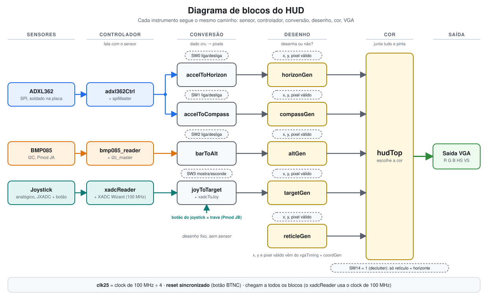
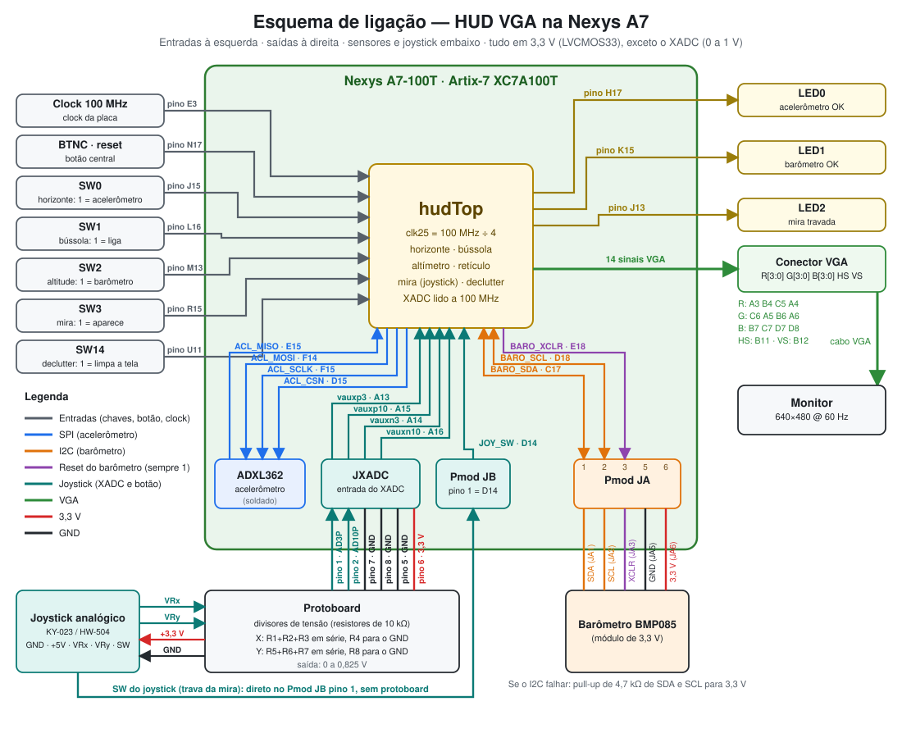
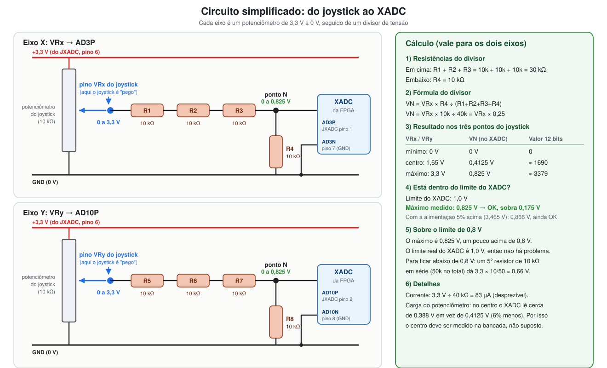
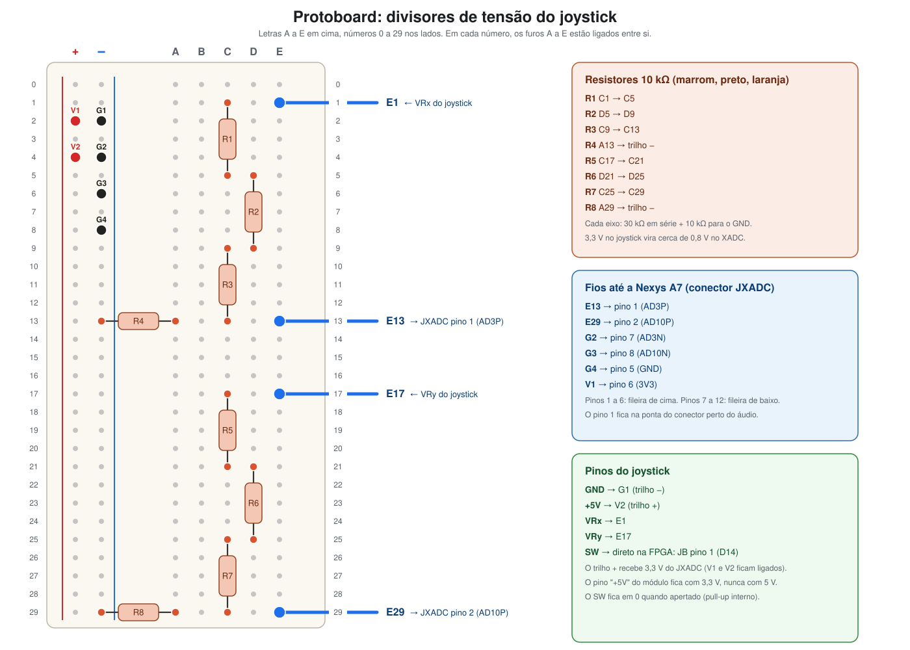

## O que é este projeto

Um HUD de avião, como aqueles que aparecem na frente do piloto. Cada pixel da tela é calculado na hora, em lógica digital, enquanto o monitor varre a imagem. Os instrumentos reagem a sensores reais ligados na placa:

| Instrumento | O que mostra | De onde vem o dado |
|---|---|---|
|  **Horizonte artificial** | Linha do horizonte que inclina e sobe/desce | Acelerômetro **ADXL362** (SPI, da própria placa) |
|  **Bússola** | Fita de graus que desliza para os lados | Acelerômetro (empurrões laterais na placa; simulação, não é o norte real) |
|  **Altímetro** | Fita de altitude com ponteiro | Barômetro **BMP085** (I2C, no Pmod JA) |
|  **Retículo** | Cruz fixa no centro da tela | Desenho fixo |
|  **Mira** | Quadrado que segue o joystick e pode travar | Joystick analógico (lido pelo **XADC**), botão do joystick para travar |

---

## Como funciona

Todo instrumento segue o mesmo caminho, em três etapas:

<p align="center">
  
</p>

1. **Controlador:** conversa com o sensor e entrega um número limpo.
2. **Conversão (`accelTo…`, `barToAlt`, `xadcToJoy` + `joyToTarget`):** transforma esse número em algo que o desenho entende: ângulo do horizonte, grau da bússola, deslocamento da fita em pixels, posição da mira. Aqui entram filtros (média móvel exponencial) e limites.
3. **Gerador de desenho (`…Gen`):** recebe a posição do pixel atual (`x`, `y`) e responde apenas **"desenha ou não desenha?"**. O `hudTop` junta as respostas e pinta.

>  O relógio da placa é de 100 MHz. O projeto usa um **clock de 25 MHz** (100 MHz ÷ 4), que é o clock de pixel do VGA 640×480.

---

## Estrutura do repositório

```
.
├── build.tcl ← gera o bitstream pelo terminal (sem abrir o Vivado)
├── program.tcl ← grava o bitstream na placa pelo terminal
├── ip/
│   └── xadc_wiz_0/
│       └── xadc_wiz_0.xci ← XADC Wizard (lê o joystick), importado pelo build.tcl
├── top/
│   └── hudTop.sv ← módulo de cima: liga tudo e escolhe a cor
├── vga/
│   ├── vgaTiming.sv ← sincronismos e contadores do VGA 640×480
│   └── coordGen.sv ← entrega x, y e "pixel válido"
├── drawings/ ← "este pixel é do instrumento?"
│   ├── horizonGen.sv
│   ├── compassGen.sv
│   ├── altGen.sv
│   ├── reticleGen.sv
│   └── targetGen.sv ← desenha a mira (quadrado; muda ao travar)
├── sensors/
│   ├── SPI/ ← acelerômetro
│   │   ├── spiMaster.sv ← envia/recebe 1 byte por SPI
│   │   ├── adxl362Ctrl.sv ← inicia e lê o ADXL362 (100 leituras/s)
│   │   ├── accelToHorizon.sv ← aceleração → inclinação do horizonte
│   │   └── accelToCompass.sv ← empurrões → ângulo da bússola
│   ├── XADC/ ← joystick analógico
│   │   ├── xadcReader.sv ← lê os eixos X e Y pelo XADC (12 bits, suavizado)
│   │   ├── xadcToJoy.sv ← 0..4095 → 0..1023, calibra o centro, gera o pulso de leitura
│   │   └── joyToTarget.sv ← joystick → posição da mira, zona morta e trava
│   └── I2C/ ← barômetro
│       ├── i2c_pkg.sv ← constantes do protocolo
│       ├── i2c_master.sv ← envia/recebe bytes por I2C
│       ├── bmp085_reader.sv ← lê a pressão do BMP085
│       └── barToAlt.sv ← pressão → deslocamento da fita de altitude
├── xdc/
│   └── nexysA7_hudTop.xdc ← qual sinal vai em qual pino da placa
└── docs/
    ├── esquematico.svg ← esquema de ligação da placa
    ├── diagrama_blocos.svg ← diagrama de blocos do HUD
    ├── circuito_joystick.svg ← circuito simplificado e cálculos do joystick
    └── protoboard_joystick.svg ← montagem da protoboard do joystick
```

---

## Como usar na placa

### Chaves e botões

| Controle | Pino | Função |
|---|:---:|---|
| `SW0` | J15 | **1** = horizonte segue o acelerômetro · **0** = horizonte fixo |
| `SW1` | L16 | **1** = bússola segue os empurrões · **0** = bússola desligada (ângulo em 0) |
| `SW2` | M13 | **1** = altitude segue o barômetro · **0** = escala parada |
| `SW3` | R15 | **1** = mira aparece e segue o joystick · **0** = mira escondida |
| `SW14` | U11 | **Declutter:** **1** = só o retículo central e a linha do horizonte · **0** = tudo aparece |
| `BTNC` | N17 | Reset |

### LEDs

| LED | Significado |
|---|---|
| `LED0` | Acelerômetro respondendo |
| `LED1` | Barômetro respondendo, sem erro |
| `LED2` | Mira travada |

### Esquema de ligação

<p align="center">
  
</p>

- **Monitor:** cabo VGA na saída da placa.
- **Barômetro BMP085:** cinco fios no **Pmod JA** (pino 1 `SDA`, 2 `SCL`, 3 `XCLR`, 5 GND, 6 3,3 V). O módulo precisa ser de **3,3 V**.
- **Acelerômetro ADXL362:** já vem soldado na placa, não precisa ligar nada.
- **Joystick:** analógico, ligado no conector **JXADC** (eixos, passando pelos divisores de tensão da protoboard) e no **Pmod JB** pino 1 (botão de trava). Veja a seção "Joystick" abaixo.

---

## Joystick: como pegar o input

O joystick do projeto é um módulo **analógico** (tipo KY-023 / HW-504), com 5 pinos: `GND`, `+5V`, `VRx`, `VRy` e `SW`. Ele não é SPI nem I2C. Cada eixo (`VRx` e `VRy`) é um potenciômetro que entrega uma **tensão**, e o `SW` é o botão de apertar.

> **Status:** a ligação de hardware e o código de leitura (`xadcReader`, `xadcToJoy`, `joyToTarget`, `targetGen`) estão escritos e integrados ao `hudTop`. O projeto compila, mas o joystick ainda não foi testado na placa.

### Por que não liga direto na FPGA

- A FPGA só lê sinais digitais (0 ou 1). Os eixos do joystick são tensões que variam de 0 até a tensão de alimentação.
- Para medir essa tensão usa-se o **XADC**, o conversor analógico-digital que já existe dentro da Artix-7. Ele fica no conector **JXADC** da placa.
- O XADC aceita só **0 a 1 V** na entrada. Por isso cada eixo passa por um **divisor de tensão** antes de entrar.

### Passo 1: alimentar o joystick com 3,3 V

Ligue o pino marcado **`+5V`** do joystick no **3V3** do JXADC (pino 6). Os potenciômetros funcionam normalmente com 3,3 V, e assim a saída nunca passa de 3,3 V.

> **Atenção:** nunca ligue o `+5V` do joystick em 5 V de verdade. A saída chegaria a 5 V e danificaria a FPGA.

### Passo 2: montar o divisor de tensão de cada eixo

Cada eixo usa **3 resistores de 10 kΩ em série** (30 kΩ) e **1 resistor de 10 kΩ para o GND**. O desenho abaixo mostra o circuito simplificado, sem a protoboard. O ponto azul é onde o joystick é "pego" (`VRx` e `VRy`), e o ponto **N** é o que entra no XADC.

<p align="center">
  
</p>

**Cálculo (vale para os dois eixos):**

```
VN = VRx × 10k ÷ (10k + 10k + 10k + 10k) = VRx × 0,25
```

| Posição do joystick | `VRx` / `VRy` | `VN` (entra no XADC) | Valor de 12 bits |
|---|:---:|:---:|:---:|
| Mínimo | 0 V | 0 V | 0 |
| Centro | 1,65 V | 0,4125 V | cerca de 1690 |
| Máximo | 3,3 V | 0,825 V | cerca de 3379 |

- O máximo (0,825 V) fica abaixo do limite de **1 V** do XADC, com folga de 0,175 V. Mesmo com a alimentação 5% acima do normal, seria 0,866 V.
- Se quiser ficar abaixo de 0,8 V, coloque um 4º resistor de 10 kΩ em série em cima (50 kΩ no total): o máximo cai para 0,66 V.
- A corrente é de 3,3 V ÷ 40 kΩ, cerca de 83 µA.
- O potenciômetro do joystick (supondo 10 kΩ) carrega um pouco o divisor, então o centro real fica perto de 0,388 V. Meça o centro na bancada em vez de supor.

A montagem na protoboard é esta (letras A a E em cima e números nos lados, igual à nossa protoboard):

<p align="center">
  
</p>

### Passo 3: ligar tudo

| Origem | Destino |
|---|---|
| Joystick `GND` | Trilho `−` da protoboard (G1) |
| Joystick `+5V` | Trilho `+` da protoboard (V2), que recebe 3,3 V do JXADC |
| Joystick `VRx` | Protoboard, furo E1 |
| Joystick `VRy` | Protoboard, furo E17 |
| Protoboard E13 (saída do divisor de VRx) | JXADC pino 1 (`AD3P`) |
| Protoboard E29 (saída do divisor de VRy) | JXADC pino 2 (`AD10P`) |
| Trilho `−` (G2) | JXADC pino 7 (`AD3N`) |
| Trilho `−` (G3) | JXADC pino 8 (`AD10N`) |
| Trilho `−` (G4) | JXADC pino 5 (GND) |
| Trilho `+` (V1) | JXADC pino 6 (3V3) |
| Joystick `SW` | **Direto** na FPGA: Pmod JB pino 1 (`D14`), sem passar pela protoboard |

- Os pinos do JXADC são numerados de 1 a 12. Os pinos 1 e 7 ficam lado a lado, na ponta oposta aos pinos de GND (5 e 11) e 3V3 (6 e 12).
- O `SW` fica em **1** solto e em **0** apertado, usando o pull-up interno da FPGA. É o botão que trava a mira: um aperto trava, outro destrava.


## Gerando o bitstream sem abrir o Vivado

Os dois scripts seguem o roteiro dos slides da disciplina (síntese em TCL).

### Requisitos

- **Vivado** instalado (testado na 2024.2). A FPGA do projeto é a `xc7a100tcsg324-1`.
- Para gravar: placa ligada no USB (porta PROG/UART) e chave de energia ligada.

### 1) Gerar o `hudTop.bit` — `build.tcl`

```bash
# Linux: carregue o ambiente uma vez e depois use `vivado` direto
vivado -mode batch -source build.tcl
```

O script cria o projeto em `build/`, adiciona todos os `.sv` e o `.xdc`, roda **síntese** e **implementação**, gera o bitstream e copia o `hudTop.bit` para a raiz do repositório. Se a síntese ou a implementação falharem, ele avisa e mostra onde está o log.

### 2) Gravar na placa — `program.tcl`

```bash
vivado -mode batch -source program.tcl
```

Funcionou quando aparecer `STATUS: DONE=1` e o LED **DONE** da placa acender. A gravação é temporária: ao desligar a placa, grave de novo.

### Relatórios gerados

Ficam em `build/reports/`:

| Arquivo | Conteúdo |
|---|---|
| `synth_util.rpt` | Uso de LUTs, flip-flops, BRAM e DSP **por módulo** (pós-síntese) |
| `synth_timing.rpt` | WNS/TNS estimados (pós-síntese) |
| `synth_power.rpt` | Potência estimada (pós-síntese) |
| `synth_log.txt` | Log da síntese (procure por `Latch` e `Multi-driven`) |
| `util.rpt` | Utilização final, depois da implementação |
| `timing.rpt` | Timing final (**WNS positivo = fechou**) |
| `power.rpt` | Potência estimada final |

<details>
<summary><b>Problemas comuns</b></summary>

- **`vivado` não é reconhecido:** o terminal não achou o programa. 
- **`ERRO: a sintese falhou`:** abra `build/hud.runs/synth_1/runme.log` e procure por `ERROR`.
- **`ERRO: a implementacao falhou`:** abra `build/hud.runs/impl_1/runme.log`. Costuma ser pino errado ou faltando no `.xdc`.
- **`program.tcl` sem achar a placa:** confira o cabo USB, a chave de energia e os drivers do cabo. No Linux, instale as regras udev do cabo Digilent.

</details>

---

## Detalhes de cada instrumento

<details>
<summary><b>Horizonte</b></summary>

`accelToHorizon` lê a aceleração em X e Y, filtra e converte em inclinação e altura da linha. `horizonGen` desenha a linha para cada `x`, sem multiplicar por pixel. Com `SW0 = 0` o horizonte fica neutro.
</details>

<details>
<summary><b>Bússola</b></summary>

`accelToCompass` separa a parte **parada** (gravidade) da parte do **empurrão**. Cada empurrão forte soma `STEP_DEG` graus, e depois há uma pausa (`LOCKOUT_READS`) para a parada da placa não contar como empurrão ao contrário. O ângulo anda aos poucos (`SLEW`) para a fita deslizar suave. É uma simulação, não o norte magnético.

Parâmetros de ajuste (na instância dentro do `hudTop`): `SWAP_XY`, `INVERT`, `FLICK_MG`, `LOCKOUT_READS`, `STEP_DEG`, `SLEW`.
</details>

<details>
<summary><b>Altitude</b></summary>

`bmp085_reader` (usando o `i2c_master`) entrega a pressão crua. `barToAlt` filtra, **captura uma referência de "chão"** depois de ~2 s e converte a diferença de pressão em pixels (sobe a altitude, a fita desce). `altGen` desenha a fita com marcas maiores e menores usando um contador sequencial por linha.

Parâmetros de ajuste: `INVERT`, `PX_PER_METER`, `FILT_SHIFT`, `ALT_LIMIT`, `SETTLE_READS`.

> O sensor é sensível a calor e a escala (pixels por metro) pode precisar de ajuste na bancada.
</details>

<details>
<summary><b>Mira e trava</b></summary>

Cadeia: joystick → `xadcReader` → `xadcToJoy` → `joyToTarget` → `targetGen`.

`xadcReader` lê os dois eixos pelo XADC (clock de 100 MHz). `xadcToJoy` calibra o centro nos primeiros ~1,2 s depois do reset (**não mexa no joystick nesse tempo**) e converte para 0..1023 com o centro em 512. `joyToTarget` aplica a zona morta, converte para pixels e liga/desliga a trava a cada aperto do botão do joystick (travada, a mira fica parada onde está). `targetGen` desenha o quadrado da mira. `SW3` mostra ou esconde a mira e o `LED2` acende quando ela está travada.

Parâmetros de ajuste: `GAIN_NUM` (no `xadcToJoy`), `SWAP_XY`, `INVERT_H`, `INVERT_V`, `DEADZONE`, `MARGIN`, `LOCK_TOGGLE` (1 = cada aperto liga/desliga a trava, 0 = trava só enquanto o botão estiver apertado), `BTN_LOCKOUT_READS` (no `joyToTarget`).
</details>

<details>
<summary><b>Modo declutter</b></summary>

Com `SW14 = 1`, só o retículo central e a linha do horizonte são desenhados. Altitude, bússola e mira ficam escondidas (os cálculos continuam rodando, só o desenho some).
</details>

---

## Próximos passos

- **Testar o joystick na placa**, ajustando `SWAP_XY`, `INVERT_H`, `INVERT_V` e `GAIN_NUM` conforme a mira se comportar.
- Fazer o vídeo aparecer atrás dos retículos.

---

## Tecnologias

SystemVerilog · Vivado · Nexys A7-100T (Artix-7) · SPI · I2C · XADC · VGA 640×480 · TCL

---

## Equipe

> Gabriel Fernandez Berger,
> Eric dos Santos Reimann,
> Guilherme Korssak Gonçaves,
> Gianluca Böckmann Baiocco,
> João Vitor Pinos Toscani

Disciplina de **Sistemas Digitais** na **PUCRS**.
