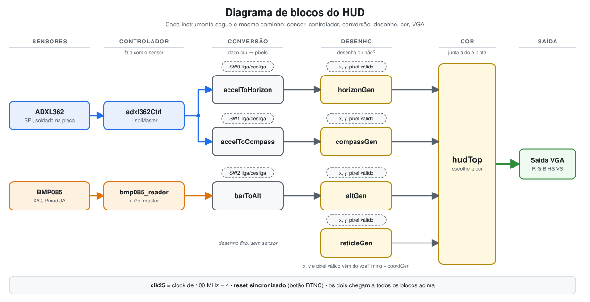
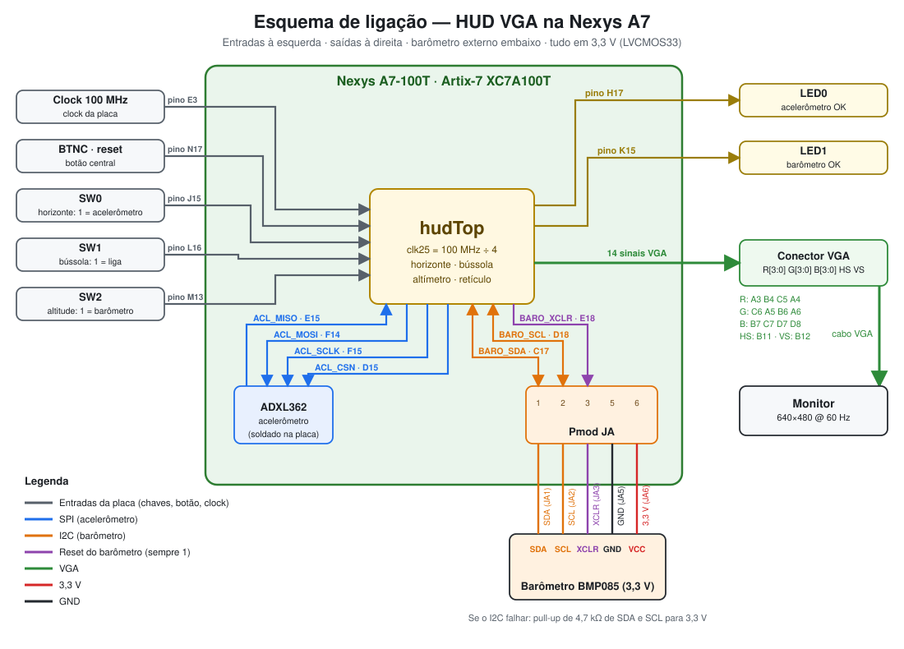

---

## O que é este projeto

Um HUD de avião, como aqueles que aparecem na frente do piloto. Cada pixel da tela é calculado na hora, em lógica digital, enquanto o monitor varre a imagem. Os instrumentos reagem a sensores reais ligados na placa:

| Instrumento | O que mostra | De onde vem o dado |
|---|---|---|
|  **Horizonte artificial** | Linha do horizonte que inclina e sobe/desce | Acelerômetro **ADXL362** (SPI, da própria placa) |
|  **Bússola** | Fita de graus que desliza para os lados | Acelerômetro (empurrões laterais na placa; simulação, não é o norte real) |
|  **Altímetro** | Fita de altitude com ponteiro | Barômetro **BMP085** (I2C, no Pmod JA) |
|  **Retículo** | Cruz fixa no centro da tela | Desenho fixo |

---

## Como funciona

Todo instrumento segue o mesmo caminho, em três etapas:

<p align="center">
  
</p>

1. **Controlador:** conversa com o sensor e entrega um número limpo.
2. **Conversão (`accelTo…`, `barToAlt`):** transforma esse número em algo que o desenho entende: ângulo do horizonte, grau da bússola, deslocamento da fita em pixels. Aqui entram filtros (média móvel exponencial) e limites.
3. **Gerador de desenho (`…Gen`):** recebe a posição do pixel atual (`x`, `y`) e responde apenas **"desenha ou não desenha?"**. O `hudTop` junta as respostas e pinta.

>  O relógio da placa é de 100 MHz. O projeto usa um **clock de 25 MHz** (100 MHz ÷ 4), que é o clock de pixel do VGA 640×480.

---

## Estrutura do repositório

```
.
├── build.tcl ← gera o bitstream pelo terminal (sem abrir o Vivado)
├── program.tcl ← grava o bitstream na placa pelo terminal
├── top/
│   └── hudTop.sv ← módulo de cima: liga tudo e escolhe a cor
├── vga/
│   ├── vgaTiming.sv ← sincronismos e contadores do VGA 640×480
│   └── coordGen.sv ← entrega x, y e "pixel válido"
├── drawings/ ← "este pixel é do instrumento?"
│   ├── horizonGen.sv
│   ├── compassGen.sv
│   ├── altGen.sv
│   └── reticleGen.sv
├── sensors/
│   ├── SPI/ ← acelerômetro
│   │   ├── spiMaster.sv ← envia/recebe 1 byte por SPI
│   │   ├── adxl362Ctrl.sv ← inicia e lê o ADXL362 (100 leituras/s)
│   │   ├── accelToHorizon.sv ← aceleração → inclinação do horizonte
│   │   └── accelToCompass.sv ← empurrões → ângulo da bússola
│   └── I2C/ ← barômetro
│       ├── i2c_pkg.sv ← constantes do protocolo
│       ├── i2c_master.sv ← envia/recebe bytes por I2C
│       ├── bmp085_reader.sv ← lê a pressão do BMP085
│       └── barToAlt.sv ← pressão → deslocamento da fita de altitude
├── xdc/
│   └── nexysA7_hudTop.xdc ← qual sinal vai em qual pino da placa
└── docs/
    └── esquematico.svg ← esquema de ligação (imagem do README)
```

---

## Como usar na placa

### Chaves e botões

| Controle | Pino | Função |
|---|:---:|---|
| `SW0` | J15 | **1** = horizonte segue o acelerômetro · **0** = horizonte fixo |
| `SW1` | L16 | **1** = bússola segue os empurrões · **0** = bússola desligada (ângulo em 0) |
| `SW2` | M13 | **1** = altitude segue o barômetro · **0** = escala parada |
| `BTNC` | N17 | Reset |

### LEDs

| LED | Significado |
|---|---|
| `LED0` | Acelerômetro respondendo |
| `LED1` | Barômetro respondendo, sem erro |

### Esquema de ligação

<p align="center">
  
</p>

- **Monitor:** cabo VGA na saída da placa.
- **Barômetro BMP085:** cinco fios no **Pmod JA** (pino 1 `SDA`, 2 `SCL`, 3 `XCLR`, 5 GND, 6 3,3 V). O módulo precisa ser de **3,3 V**.
- **Acelerômetro ADXL362:** já vem soldado na placa, não precisa ligar nada.
- O acelerômetro ADXL362 já está soldado na placa, não precisa ligar nada.

---

## Gerando o bitstream sem abrir o Vivado

Os dois scripts seguem o roteiro dos slides da disciplina (síntese em TCL).

### Requisitos

- **Vivado** instalado (testado na 2026.1). A FPGA do projeto é a `xc7a100tcsg324-1`.
- Para gravar: placa ligada no USB (porta PROG/UART) e chave de energia ligada.

### 1) Gerar o `hudTop.bit` — `build.tcl`

```bash
# Linux: carregue o ambiente uma vez e depois use `vivado` direto
vivado -mode batch -source build.tcl
```

O script cria o projeto em `build/`, adiciona todos os `.sv` e o `.xdc`, roda **síntese** e **implementação**, gera o bitstream e copia o `hudTop.bit` para a raiz do repositório. Se a síntese ou a implementação falharem, ele avisa e mostra onde está o log.

### 2) Gravar na placa — `program.tcl`

```bash
vivado -mode batch -source program.tcl
```

Funcionou quando aparecer `STATUS: DONE=1` e o LED **DONE** da placa acender. A gravação é temporária: ao desligar a placa, grave de novo.

### Relatórios gerados

Ficam em `build/reports/`:

| Arquivo | Conteúdo |
|---|---|
| `synth_util.rpt` | Uso de LUTs, flip-flops, BRAM e DSP **por módulo** (pós-síntese) |
| `synth_timing.rpt` | WNS/TNS estimados (pós-síntese) |
| `synth_power.rpt` | Potência estimada (pós-síntese) |
| `synth_log.txt` | Log da síntese (procure por `Latch` e `Multi-driven`) |
| `util.rpt` | Utilização final, depois da implementação |
| `timing.rpt` | Timing final (**WNS positivo = fechou**) |
| `power.rpt` | Potência estimada final |

<details>
<summary><b>Problemas comuns</b></summary>

- **`vivado` não é reconhecido:** o terminal não achou o programa. 
- **`ERRO: a sintese falhou`:** abra `build/hud.runs/synth_1/runme.log` e procure por `ERROR`.
- **`ERRO: a implementacao falhou`:** abra `build/hud.runs/impl_1/runme.log`. Costuma ser pino errado ou faltando no `.xdc`.
- **`program.tcl` sem achar a placa:** confira o cabo USB, a chave de energia e os drivers do cabo. No Linux, instale as regras udev do cabo Digilent.

</details>

---

## Detalhes de cada instrumento

<details>
<summary><b>Horizonte</b></summary>

`accelToHorizon` lê a aceleração em X e Y, filtra e converte em inclinação e altura da linha. `horizonGen` desenha a linha para cada `x`, sem multiplicar por pixel. Com `SW0 = 0` o horizonte fica neutro.
</details>

<details>
<summary><b>Bússola</b></summary>

`accelToCompass` separa a parte **parada** (gravidade) da parte do **empurrão**. Cada empurrão forte soma `STEP_DEG` graus, e depois há uma pausa (`LOCKOUT_READS`) para a parada da placa não contar como empurrão ao contrário. O ângulo anda aos poucos (`SLEW`) para a fita deslizar suave. É uma simulação, não o norte magnético.

Parâmetros de ajuste (na instância dentro do `hudTop`): `SWAP_XY`, `INVERT`, `FLICK_MG`, `LOCKOUT_READS`, `STEP_DEG`, `SLEW`.
</details>

<details>
<summary><b>Altitude</b></summary>

`bmp085_reader` (usando o `i2c_master`) entrega a pressão crua. `barToAlt` filtra, **captura uma referência de "chão"** depois de ~2 s e converte a diferença de pressão em pixels (sobe a altitude, a fita desce). `altGen` desenha a fita com marcas maiores e menores usando um contador sequencial por linha.

Parâmetros de ajuste: `INVERT`, `PX_PER_METER`, `FILT_SHIFT`, `ALT_LIMIT`, `SETTLE_READS`.

> O sensor é sensível a calor e a escala (pixels por metro) pode precisar de ajuste na bancada.
</details>

---

## Próximos passos

- Controle da **mira / alvo** por joystick, com travamento (lock).
  O joystick que temos é analógico, então serão necessários um divisor de tensão e o **XADC** da FPGA. A alternativa é um Pmod JSTK2 (SPI).
- Travamento da mira **relativo ao horizonte**, como pede a especificação.
- Fazer o vídeo aparecer atrás dos retículos.
---

## Tecnologias

SystemVerilog · Vivado · Nexys A7-100T (Artix-7) · SPI · I2C · VGA 640×480 · TCL

---

## Equipe

> Gabriel Fernandez Berger,
> Eric dos Santos Reimann,
> Guilherme Korssak Gonçaves,
> Gianluca Böckmann Baiocco,
> João Vitor Pinos Toscani

Disciplina de **Sistemas Digitais** na **PUCRS**.
